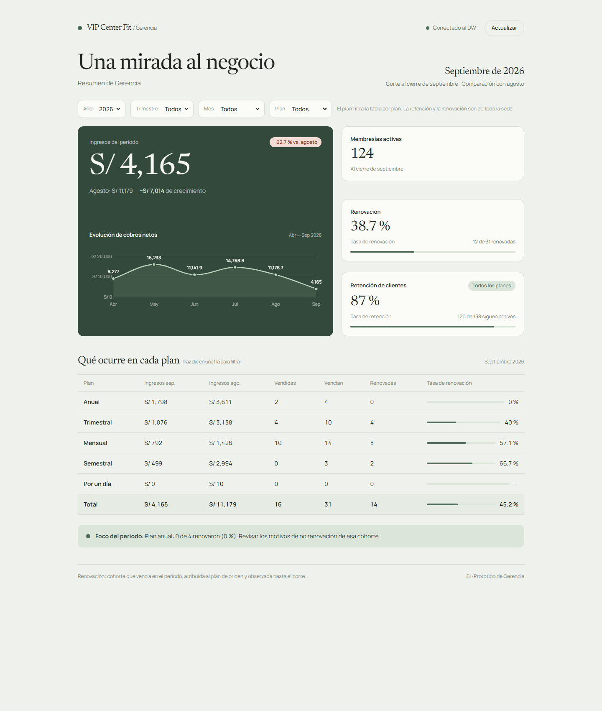

# VIP Center Fit · Dashboard BI

Panel analítico de **Business Intelligence** para la gestión de un gimnasio. Muestra a Gerencia
General la evolución de los ingresos, la salud de la base de membresías y el desempeño por plan,
todo a partir del Data Warehouse.



## Qué incluye

- **KPIs del periodo** — ingresos actuales frente al periodo anterior, membresías activas,
  tasa de renovación y tasa de retención de clientes.
- **Evolución de cobros netos** — mini-serie de los últimos seis meses con etiquetas de valor.
- **Tabla por plan** — ingresos del periodo y del previo, membresías vendidas, vencimientos,
  renovaciones y tasa de renovación por tipo de plan.
- **Foco del periodo** — detecta el plan con menor tasa de renovación para actuar sobre esa cohorte.
- **Filtros funcionales** — año, trimestre, mes y plan; clic en una fila de la tabla para filtrar.
- **Estados de carga y error** en la lectura de datos.

## Stack

| Capa | Tecnología |
| --- | --- |
| Framework | Angular 21 · standalone · zoneless · Signals |
| Estado | `@ngrx/signals` (`signalStore`) |
| Estilos | Tailwind CSS v4 (`@tailwindcss/postcss` + `@theme`) |
| Gráficos | Chart.js 4 |
| HTTP | `HttpClient` con `provideHttpClient(withFetch())` |
| Pruebas | Vitest (`@angular/build:unit-test`) |

## Cómo ejecutarlo

Requiere **Node.js 20.19+**, **22.12+** o **24+** (Angular 21).

```bash
npm install

npm start        # desarrollo en http://localhost:4200
npm run build    # build de producción en dist/
npm test         # pruebas con Vitest
```

La app consume la API pública del Data Warehouse
(`https://vip-center-fit-bi.lrydev.me/api/v1`), configurada en `src/environments/`.

## Arquitectura

```text
src/app/
├── core/                     # sin UI: modelos, formatters, lógica pura y acceso HTTP
│   ├── kpi.models.ts         # DTOs del DW + modelos de vista
│   ├── dw-api.service.ts     # único punto de acceso a la API
│   ├── kpi.helpers.ts        # reglas de negocio puras (probadas)
│   ├── catalogs.ts
│   └── format.ts
├── shared/                   # componentes reutilizables
│   ├── kpi-card.ts · progress-bar.ts · filter-bar.ts · chart.ts
└── features/gerencia/        # el panel
    ├── gerencia.store.ts     # signalStore: datos, filtros y derivados
    ├── gerencia-page.ts/.html
    └── tabla-planes.ts
```

La lógica de negocio vive en **funciones puras** (`core/kpi.helpers.ts`), lo que permite probarla sin
Angular y reutilizarla desde el store.

## Datos y reglas

Endpoints consumidos:

| Endpoint | Contenido |
| --- | --- |
| `GET /kpis/gerencia/ingresos` | ingresos por mes (actual y anterior) y variación |
| `GET /kpis/gerencia/membresias` | clientes activos, retención y cohortes de renovación |
| `GET /kpis/comercial/planes` | ingresos y membresías por tipo de plan |

Reglas aplicadas:

- Se toma el **último periodo con actividad** (el DW proyecta años futuros vacíos).
- Los **flujos y cohortes** se suman (`ingresos`, `ventas`, `vencían`, `renovadas`); las
  **métricas puntuales** (`membresías activas`, retención) se toman del último mes del rango.
- `DM_Comercial_Plan` devuelve varias filas por `tipo_plan` (`DimPlan` unifica plan, operación y
  promoción), así que se **agrupa por `tipo_plan`** antes de sumar.
- El filtro de **plan** aplica a la tabla; la retención y la renovación son de toda la sede.

## Documentación

- [`docs/constitution.md`](docs/constitution.md) — estructura, flujo de trabajo y reglas del proyecto.
- [`specs/001-gerencia-general/`](specs/001-gerencia-general/) — especificación, plan y tareas.
- [`tests/README.md`](tests/README.md) — convención de pruebas.

## Backend

El Data Warehouse y la API (ASP.NET Core + SQL Server, modelo Kimball en constelación) viven en un
repositorio aparte: [leroy-s2/vip-center-fit-bi](https://github.com/leroy-s2/vip-center-fit-bi).
